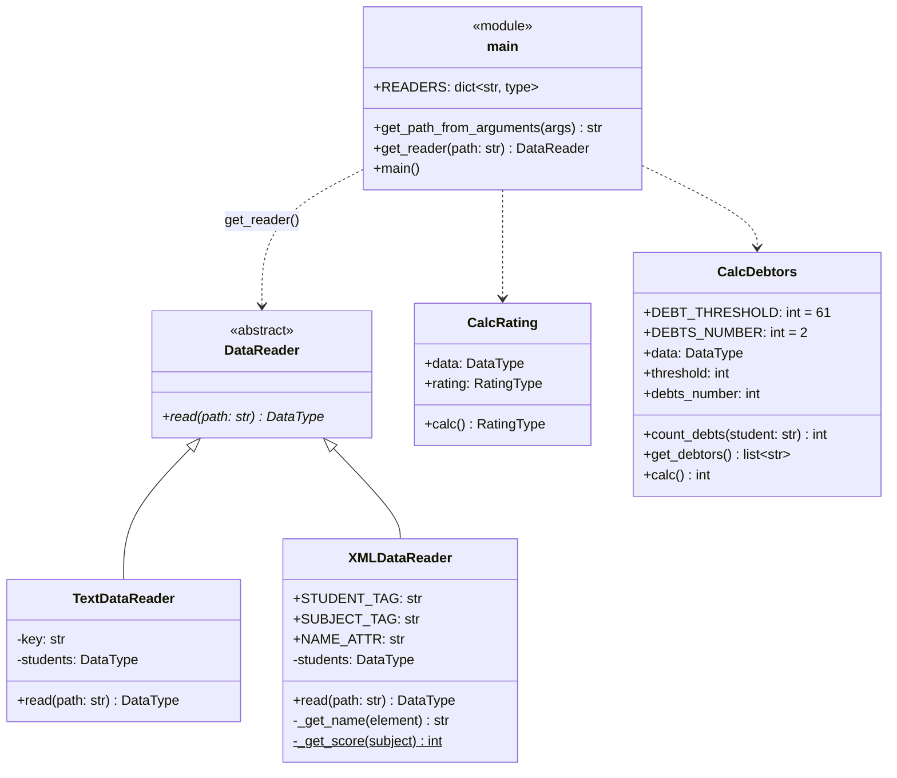

# Лабораторная 1 по дисциплине "Технологии программирования"

[](https://github.com/DimITRII333/rating-Tikhonov/actions/workflows/github-actions-testing.yml)

**Тема:** знакомство с системой контроля версий Git и инструментом CI/CD GitHub Actions.

## Цели работы

1. Познакомиться с распределённой системой контроля версий Git и её функциями.
2. Познакомиться с понятиями «непрерывная интеграция» (CI) и «непрерывное развёртывание» (CD).
3. Получить навыки разработки ООП-программ и написания модульных тестов к ним.
4. Получить навыки работы с Git для хранения и управления версиями ПО.
5. Получить навыки автоматизированного тестирования ПО с помощью GitHub Actions.

## Постановка задачи

Учебный проект `rating` рассчитывает средний рейтинг студентов по дисциплинам. Список студентов
и их оценок задаётся во входном файле.

**Индивидуальное задание, вариант 10:**

| Формат входного файла | Расчётная процедура |
|---|---|
| XML | Рассчитать и вывести на экран количество студентов, имеющих академические задолженности (балл < 61) **ровно по двум** предметам. |

Дополнительно:

1. выбрать лицензию и добавить её в проект;
2. добавить и заполнить `.gitignore`;
3. добавить наследника `DataReader` для чтения XML и модульные тесты к нему (в отдельной ветке, затем слияние с `main`);
4. добавить класс расчёта по варианту и модульные тесты к нему (в отдельной ветке, затем слияние с `main`);
5. составить UML-диаграмму классов;
6. сделать выводы.

## Описание проекта

```text
rating-Tikhonov
├── .github/workflows/github-actions-testing.yml   # CI: pycodestyle + pytest на каждый push в main
├── data
│   ├── data.txt              # входные данные в текстовом формате
│   └── data.xml              # входные данные в формате XML (вариант 10)
├── src
│   ├── Types.py              # псевдоним типа DataType
│   ├── DataReader.py         # абстрактный класс чтения данных
│   ├── TextDataReader.py     # чтение .txt
│   ├── XMLDataReader.py      # чтение .xml (вариант 10)
│   ├── CalcRating.py         # расчёт среднего рейтинга
│   ├── CalcDebtors.py        # подсчёт студентов с двумя задолженностями (вариант 10)
│   └── main.py               # точка входа, выбор читателя по расширению файла
├── test                      # модульные тесты pytest для каждого класса
├── .gitignore
├── LICENSE                   # MIT
├── README.md
└── requirements.txt
```

### Формат XML

В примере из методических указаний ФИО и названия дисциплин используются как **имена тегов**
(`<Иванов Иван Иванович>`). Такой документ невалиден: имя XML-элемента не может содержать пробелов,
поэтому ни одна библиотека его не разберёт. Поэтому имена вынесены в атрибут `name`, а структура
вложенности сохранена:

```xml
<?xml version="1.0" encoding="UTF-8" ?>
<root>
    <student name="Иванов Иван Иванович">
        <subject name="математика">67</subject>
        <subject name="литература">100</subject>
        <subject name="программирование">91</subject>
    </student>
</root>
```

Разбор выполняется стандартной библиотекой `xml.etree.ElementTree`. Если у студента или предмета
нет атрибута `name` либо балл не является целым числом, выбрасывается `ValueError`. Если XML
синтаксически некорректен, выбрасывается `xml.etree.ElementTree.ParseError`.

### Расчёт задолженностей

Класс `CalcDebtors` считает для каждого студента количество предметов с баллом ниже порога
(`threshold = 61`) и отбирает студентов, у которых таких предметов ровно `debts_number = 2`.
Порог и число задолженностей вынесены в параметры конструктора со значениями по умолчанию
из варианта. Метод `calc()` возвращает количество таких студентов, `get_debtors()` возвращает их список.

### Запуск

```powershell
python -m venv .venv
.venv\Scripts\activate
pip install -r requirements.txt

pycodestyle src test                 # проверка PEP8
$env:PYTHONPATH = ".;./src"           # в Windows разделитель путей — ';'
pytest test                          # модульные тесты

python src\main.py -p data\data.xml
```

Пример вывода для `data/data.xml`:

```text
Students:  {'Иванов Иван Иванович': [('математика', 67), ...], ...}
Rating:  {'Иванов Иван Иванович': 86.0, 'Петров Петр Петрович': 75.33, 'Сидоров Сидор Сидорович': 61.0, ...}
Students with debts in exactly two subjects:  2
```

## Используемые технологии

- **Python 3.10+**: язык, аннотации типов (Type Hints), `abc` для абстрактных классов;
- **xml.etree.ElementTree**: разбор XML;
- **pytest**: модульное тестирование (фикстуры, `tmpdir`, `parametrize`, `monkeypatch`, `capsys`);
- **pycodestyle**: проверка соответствия PEP8;
- **Git / GitHub**: контроль версий, ветвление (`feature/xml-reader`, `feature/debtors-count`) и слияние `--no-ff`;
- **GitHub Actions**: CI, автоматический запуск линтера и тестов при каждом push в `main`.

## UML-диаграмма классов



`DataType = dict[str, list[tuple[str, int]]]`: ФИО студента → список пар (дисциплина, балл).

## Тестирование

36 модульных тестов, **покрытие кода 98%** (по `pytest-cov`). Не покрыты только тело абстрактного
метода `DataReader.read` и строка `if __name__ == "__main__"`.

| Модуль | Что проверяется |
|---|---|
| `test_XMLDataReader.py` | корректное чтение; наследование от `DataReader`; повторное чтение не накапливает данные; обрезка пробелов; пустой корень; студент без предметов; отсутствие `name`; нецелый / пустой балл; битый XML; несуществующий файл |
| `test_CalcDebtors.py` | граница 61 (не долг) / 60 (долг); 0, 1, 2, 3 задолженности; студент без предметов; пустые данные; пользовательские порог и число долгов; неизвестный студент |
| `test_main.py` | разбор аргументов; выбор читателя по расширению (в т.ч. в верхнем регистре); неподдерживаемый формат; сквозной запуск `main()` на XML-файле |
| `test_CalcRating.py`, `test_TextDataReader.py` | исходные тесты из методических указаний |

Работа CI проверена так: коммит с намеренной ошибкой в `CalcRating` (`16f1b0c`) дал красный статус,
после исправления (`8aaa9d4`) статус снова зелёный.

## Выводы

1. Освоены основные операции Git: инициализация репозитория, индексирование и фиксация изменений,
   работа с удалённым репозиторием (`remote`, `push`), ветвление и слияние. Каждое задание сделано
   в отдельной feature-ветке и влито в `main` через `merge --no-ff`, поэтому история изменений
   осталась наглядной.
2. Настроен конвейер CI на GitHub Actions: каждый push в `main` автоматически проверяет код
   на соответствие PEP8 и запускает тесты. Эксперимент с намеренной ошибкой показал, что CI сразу
   сигнализирует о регрессии, и ошибка не остаётся незамеченной.
3. Абстрактный класс `DataReader` позволил добавить поддержку XML без изменения существующих классов
   (принцип открытости/закрытости). Выбор читателя по расширению файла в `main.py` сводит добавление
   нового формата к одной строке в словаре `READERS`.
4. Модульные тесты написаны не только на основной сценарий, но и на граничные и ошибочные случаи.
   Они помогли выявить тонкость структуры проекта: модули `src` импортируют друг друга без префикса
   `src.`, поэтому один и тот же класс может загрузиться дважды под разными именами модулей.
5. Пример XML из методических указаний невалиден (пробелы в именах тегов), поэтому формат был
   скорректирован. Данные хранятся в атрибутах, а разбор выполняется стандартной библиотекой.

## Лицензия

Проект распространяется под лицензией [MIT](LICENSE).
